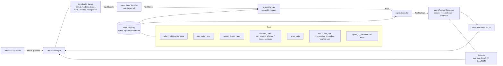

# SatQuery AI

Agentic vision-language assistant for satellite imagery (SIH 2026, PS SIH26167, ISRO).

Upload one or two GeoTIFFs and ask a question. SatQuery validates the inputs, classifies
the question, and plans a chain of specialist tools from a registry. It then runs them,
fuses their outputs and returns a **grounded answer** with **visual evidence** (overlays,
GeoTIFF / GeoJSON masks), a **confidence score** and an **auditable execution trace**.

Supported inputs:
- a single optical / multispectral or SAR image;
- a co-registered optical + SAR pair;
- a bi-temporal pair (two dates, optical–optical or SAR–SAR).

Phase 1 answers with **classical tools**: water, built-up, vegetation, change, fusion and
area. Placeholder **mock tools** sit where vision-language models will go. An optional
zero-shot Qwen-VL tool is available behind the `[ml]` extra.

## Setup

Needs Python 3.12, [uv](https://docs.astral.sh/uv/), [just](https://github.com/casey/just)
(`uv tool install rust-just`) and Node ≥ 20 for the UI. Everything runs on a CPU-only laptop.

```sh
just install      # .venv (core + dev), git hooks, UI packages
just test         # pytest (synthetic GeoTIFF fixtures, no real data)
just lint         # ruff + UI type-check
just demo-data    # synthetic demo GeoTIFFs in data/demo
just serve        # build the UI, then API + UI on http://127.0.0.1:8000
```

For development with hot reload, run `just dev-api` and `just dev-ui` in two terminals and
open http://localhost:5173.

Optional extras:
- `just install-eval` adds the benchmark metrics (pycocoevalcap; METEOR needs Java).
- `just install-ml` adds torch and transformers. It is a large download.

Settings are environment variables prefixed `SATQUERY_` (see `src/satquery/config.py`):

| Variable | Default | Meaning |
|---|---|---|
| `SATQUERY_DATA_DIR` | `data` | per-request uploads and outputs |
| `SATQUERY_MAX_UPLOAD_MB` | `512` | upload size limit |
| `SATQUERY_MIN_OVERLAP_IOU` | `0.5` | minimum footprint IoU for image pairs |
| `SATQUERY_VLM_ENABLED` | `false` | offer the Qwen-VL tool to the planner |
| `SATQUERY_VLM_MODEL_ID` | `Qwen/Qwen3-VL-2B-Instruct` | Hugging Face model id |
| `SATQUERY_VLM_ALLOW_DOWNLOAD` | `false` | allow downloading weights (otherwise local cache only) |

## Architecture



| Package | Responsibility |
|---|---|
| `satquery.io` | Inspect rasters, detect modality, resolve band roles, validate/align inputs, preprocess (SAR dB/Lee, optical stretch, temporal normalisation), tiling, rendering, GeoJSON |
| `satquery.tools` | `Tool` interface, `Registry`, classical, mock and ML tools |
| `satquery.agent` | Classifier → Planner → Executor → AnswerComposer, `ExecutionTrace`, `analyze()` |
| `satquery.api` | FastAPI app, per-request storage |
| `satquery.eval` | Benchmark loaders, metrics, runner, `satquery-eval` CLI |
| `ui/` | Vite + React + TypeScript single page |

**Example.** "Has built-up area increased?" on a bi-temporal pair runs this plan:
1. NDBI mask on date 1 and on date 2;
2. `mask_compare` (gain/loss) → `area_stats` (hectares);
3. `change_cva` as an independent cross-check.

The composer answers yes/no with gained and lost hectares and both dates. Its confidence
is the NDBI threshold margin scaled by agreement with CVA. Every step, parameter and
runtime lands in the trace.

## API

| Endpoint | Description |
|---|---|
| `POST /analyze` | multipart: `files` (1–2), `query`, optional per-file `modality_1/2`, `date_1/2` (`YYYY-MM-DD`), `band_map_1/2` (JSON, 1-based, e.g. `{"green": 2, "nir": 4}`), `benchmark` (allow PNG/JPEG). Returns answer, confidence, artifact URLs and the full trace. Rejected inputs return **422 with a structured error and the trace**. |
| `GET /tools` | registry export: every tool's spec and parameter JSON schema |
| `GET /health` | version, tool count, VLM availability |
| `GET /requests/{id}/files/{name}` | overlays, masks (GeoTIFF / GeoJSON), `trace.json` |

Errors always carry a stable `code` (e.g. `task_input_mismatch`, `band_role_missing`,
`no_overlap`, `crs_mismatch`), a message, details and usually a hint.

## Adding a tool

1. Subclass `Tool` (`src/satquery/tools/base.py`) and declare what it does.
2. Register it in `default_registry()` (`src/satquery/tools/registry.py`), or call
   `registry.register(MyTool())`.
3. Add a test on the synthetic fixtures (`tests/unit/tools/`). `satquery.testing.helpers.run_tool`
   runs a tool directly.

```python
from pydantic import Field
from satquery.tools.base import Tool, ToolInput, ToolOutput, ToolParams, ToolRequirements
from satquery.types import BandRole, Capability, InputConfig, TaskType


class MyWaterParams(ToolParams):  # extra="forbid": only these params can be set
    threshold: float = Field(default=0.1, ge=-1, le=1)


class MyWaterModel(Tool):
    name = "my_water_model"
    version = "0.1.0"
    description = "Water segmentation with <model>."
    tasks = frozenset({TaskType.VQA, TaskType.FUSION_EXTRACT})
    input_configs = frozenset({InputConfig.SINGLE_OPT, InputConfig.PAIR_OPT_SAR})
    produces = frozenset({Capability.MASK_WATER})  # the planner chains by capability
    requires = ToolRequirements(
        n_layers=1, modality="optical", bands=((BandRole.GREEN,), (BandRole.NIR,))
    )
    Params = MyWaterParams
    priority = 20  # beats ndwi_water_mask (10) when usable

    def run(self, inp: ToolInput, params: MyWaterParams) -> ToolOutput:
        layer = inp.layer()  # RasterLayer on the reference grid
        mask = ...  # (H, W) bool
        return ToolOutput(
            masks={"mask": layer.georaster(mask)},  # keeps transform + CRS
            values={"class": "water", "pixels": int(mask.sum())},
            confidence=0.8,
            confidence_basis="mean softmax probability",
        )
```

No planner change is needed: recipes ask the registry for `Capability.MASK_WATER`, and the
highest-ranked tool that fits the actual layers (available > real > priority) is chosen.
Unknown or out-of-range parameters are rejected with `invalid_params`. Runtime,
parameters, output summary and confidence are traced automatically.

## Evaluation

```sh
satquery-eval --list                                         # benchmarks, sources, tools
satquery-eval --benchmark rsvqa-lr --tool vlm_vqa --subset 500
satquery-eval --benchmark rsvqa-lr --tool pipeline --subset 100
```

Each run writes `results/<benchmark>_<tool>_<timestamp>.json` (all per-sample records)
and a Markdown summary. Every run records the tool version, mock flag, registry digest,
git commit, subset size and seed, so future fine-tuned models are compared like for like.

Metrics:
- VQA: overall and average accuracy, per question type.
- Captioning: BLEU-4, METEOR and CIDEr.
- Grounding: Acc@IoU ≥ 0.5 and mean IoU.
- Change masks: precision, recall, F1 and IoU.

Loaders exist for RSVQA-LR, VRSBench (VQA / caption / grounding), CDVQA and BigEarthNet.txt.
Sources are listed in `src/satquery/eval/sources.py`. Datasets are **never downloaded
automatically**: place them under `datasets/<name>` or pass `--data-root`.

See `PROGRESS.md` for status and open questions.
